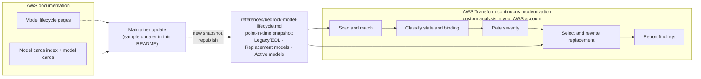

# Bedrock Model Lifecycle Detector

Finds every place a repository references an Amazon Bedrock model, from any provider, that is Legacy or End-of-Life (EOL) on Bedrock. Each reference is rated by lifecycle state, EOL date and whether it sits on an active code path. Each one also gets a named replacement: the latest Active model in the same model family, written in the same form as the original reference so it can be swapped in directly.

**Analysis only: no file in the repository is modified. Run it only as an AWS Transform continuous modernization custom analysis.**

**Covers Python · TypeScript · JavaScript · Java · Go · C# · Jupyter notebooks · CloudFormation · SAM · CDK · Terraform · YAML/JSON/TOML/env config · shell scripts · docs**

## Table of Contents

- [Overview](#overview)
- [The Problem](#the-problem)
- [What This Transformation Does](#what-this-transformation-does)
- [Transformation Architecture](#transformation-architecture)
- [How Replacements Are Chosen](#how-replacements-are-chosen)
- [Keeping the Reference Current](#keeping-the-reference-current)
- [Getting Started](#getting-started)
- [Troubleshooting](#troubleshooting)
- [Known Limitations](#known-limitations)
- [Documentation & References](#documentation--references)
- [Repository Structure](#repository-structure)

## Overview

Amazon Bedrock moves models through a one-way lifecycle: Active, then Legacy (an EOL date is announced), then EOL (requests fail). Model IDs are spread across application code, infrastructure templates, IAM policies, config files and notebooks, often in several forms of the same ID: a base ID, a cross-region inference profile ID, an ARN, or a framework-prefixed ID such as LiteLLM `bedrock/...`.

This transformation finds those references, looks each one up in a point-in-time snapshot of the AWS documentation, and reports how urgent it is and exactly what to replace it with. It never judges a model by the version number in its ID; the lifecycle state and the replacement both come from the reference file.

## The Problem

- **Deprecation is announced on a documentation page, not in your code.** Nothing fails until the EOL date, and then requests in the listed Regions fail outright.
- **Legacy models degrade before they stop.** New customers cannot use them, existing customers can lose access after 15 days of inactivity, no new Provisioned Throughput or fine-tuning is allowed, and from the public extended access date the provider may charge higher prices.
- **The same model hides in many forms.** `us.anthropic.claude-3-5-sonnet-20241022-v2:0`, `arn:aws:bedrock:us-west-2::foundation-model/anthropic.claude-3-5-sonnet-20241022-v2:0` and `bedrock/anthropic.claude-3-5-sonnet-20241022-v2:0` are one model. 
- **"Upgrade to a newer model" is not actionable.** Teams need to know which model, which ID form, and whether the replacement needs an inference profile. Newer Bedrock models often accept on-demand requests only through an inference profile, so swapping in a bare base ID can fail with a `ValidationException`.
- **Not every reference matters equally.** A hardcoded ID passed to `converse` breaks production; a parameter default in a template or an example in a README does not select the model at runtime.

## What This Transformation Does

1. **Scan** application source, notebooks, infrastructure templates, config files, shell scripts and docs, skipping build output and vendored content (`node_modules/`, `venv/`, `dist/`, `cdk.out/`, lock files and similar).
2. **Match** every Legacy, EOL and retired model ID from the reference file, in all of its forms: base ID, inference profile ID, ARN, bedrock-mantle variant ID, framework-prefixed ID, with or without the `:N` version or a context-window suffix.
3. **Classify** each reference:
   - lifecycle state as of the analysis date (`eol` or `legacy`), re-derived from the EOL dates rather than trusted from the snapshot;
   - binding type: `hardcoded-active`, `env-default-active`, `infrastructure-active`, `configuration-option` or `test-or-sample`.
4. **Rate** severity under the single category `Model Risk`:

   | Severity | Rule |
   |---|---|
   | high | Active code path and `eol`, or active code path and `legacy` with the EOL date within 90 days |
   | medium | Active code path and `legacy` with the EOL date more than 90 days away |
   | low | Configuration option, test or sample, documentation or prose |

5. **Recommend** a replacement for every finding, including `low` ones, from the Replacement models table (see [How Replacements Are Chosen](#how-replacements-are-chosen)). Example:

   > Replace `us.anthropic.claude-3-5-sonnet-20241022-v2:0` with `us.anthropic.claude-sonnet-5-5` (Claude Sonnet 5.5, the latest Active model in the Claude Sonnet family, launched 2026-09-28) before 2026-11-13.

6. **Report** to `.model-risk/findings.json` (machine-readable) and `.model-risk/findings.md` (summary with counts by severity and findings grouped by file).

## Transformation Architecture



### Key Design Decisions

1. **The reference file is the single source of truth.** Lifecycle state, dates, Regions and replacements are read from `references/bedrock-model-lifecycle.md`, never from memory or from the version number in an ID. 
2. **The reference is data only.** It is a point-in-time snapshot with its date at the top. The skill ships no script and calls no AWS or Amazon Bedrock API, so it needs no Bedrock permissions. Taking a new snapshot is a maintainer task outside the skill (see [Keeping the Reference Current](#keeping-the-reference-current)).
3. **Severity follows the code path, not the model.** The same EOL model is `high` in a `converse` call and `low` in a README.

## How Replacements Are Chosen

Each finding's replacement is the latest Active model in the same provider's model family, taken from the Replacement models table, and rewritten in the same form as the original reference (prefix, ARN shape, endpoint), with an inference profile when the replacement needs one. When that model is not offered on the reference's endpoint or through an inference profile for the deployment's geography, the latest family member that is gets recommended instead, and the newer model is listed as an alternative. The rules live in one place each:

- How families and replacements are derived, and the family overrides: [Model families and replacements](references/bedrock-model-lifecycle.md#model-families-and-replacements) and [Family overrides](references/bedrock-model-lifecycle.md#family-overrides) in the reference file.
- How the analysis picks a row and rewrites the ID (endpoint, ties, endpoint and geography reachability, size and modality fit, inference profile prefix, ARNs, families with no Active model): Implementation Steps 5 and 6 and Severity Criteria in [SKILL.md](SKILL.md#implementation-steps).

## Keeping the Reference Current

The reference file is a point-in-time snapshot. Snapshot of 2026-11-03: 62 lifecycle rows for 56 Legacy or EOL model IDs (14 `eol` and 48 `legacy` rows), 4 retired models, and 98 Active model IDs from 138 model cards. 30 of the 60 Legacy, EOL and retired model IDs have a same-family Active replacement.

The skill does not include an updater. To take a new snapshot, write a script that rebuilds the tables from the AWS documentation; the sample below is a starting point. It uses only the Python 3 standard library and needs no AWS credentials, and it was last run end to end with Python 3.13 to take the 2026-11-03 snapshot. It fetches the two Bedrock lifecycle pages (HTML), the `model-cards.md` index and every `model-card-*.md` it links to (Markdown), over HTTPS from `docs.aws.amazon.com` only and size-capped, derives the families and replacements as described in the reference file, and prints the three tables as Markdown.

1. Save the script as `update_reference_sample.py` and run it from the root of this repository:

   ```bash
   python3 update_reference_sample.py community-sourced-transformations/continuous-modernization/analysis/bedrock-model-lifecycle-detector/references/bedrock-model-lifecycle.md > tables.md
   ```

2. Replace the tables under "Legacy and EOL models", "Replacement models" and "Active models" with the printed ones, and update the snapshot date at the top of the file and the counts above the tables.
3. Act on the notes printed to stderr:

   | Note | Action |
   |---|---|
   | `no longer on the lifecycle pages` | Add the model IDs to the "Retired models no longer listed in the docs" table |
   | `no Active model in the family of` | Add a "Family overrides" row if a real successor exists, then run the script again |

4. Review the diff of the reference file, bump the version at the top of `SKILL.md`, then republish the skill (see [Cloning the Repo and Publishing the Transformation](#cloning-the-repo-and-publishing-the-transformation)).

<details>
<summary><code>update_reference_sample.py</code></summary>

```python
#!/usr/bin/env python3
"""Sample updater for references/bedrock-model-lifecycle.md.

Fetches the Amazon Bedrock model lifecycle pages and model cards and prints the
three snapshot tables (Legacy and EOL models, Replacement models, Active models)
as Markdown. Review the output, paste each table over the matching table in the
reference file, and update the snapshot date and the counts above the tables.

Usage: python3 update_reference_sample.py references/bedrock-model-lifecycle.md > tables.md
The reference file is read only for its hand-maintained "Retired models" and
"Family overrides" tables. Python 3 standard library only.
"""
import datetime as dt
import re
import sys
import urllib.parse
import urllib.request
from concurrent.futures import ThreadPoolExecutor
from html.parser import HTMLParser

BASE = "https://docs.aws.amazon.com/bedrock/latest/userguide/"
LIFECYCLE_PAGES = ["model-lifecycle.html", "model-lifecycle-legacy.html"]
MAX_BYTES = 5_000_000
TODAY = dt.datetime.now(dt.timezone.utc).date().isoformat()
# A Bedrock model ID, optionally followed by an endpoint: "deepseek.v3.1 (bedrock-mantle)".
ID_RE = re.compile(r"([A-Za-z0-9][\w-]*\.[\w.:-]+)\s*(?:\(\s*([^)]*?)\s*\))?")
REGION_RE = re.compile(r"\b[a-z]{2}(?:-gov)?-[a-z]+-\d+\b")
CARD_LINK_RE = re.compile(r"\[([^\]]+)\]\((model-card-[\w.-]+\.md)\)")
# Lifecycle table column -> header substrings.
COLUMNS = {"id": ("model id",), "eol": ("eol date", "end-of-life date"),
           "legacy": ("legacy date",), "extended": ("extended access",),
           "provider": ("provider",), "name": ("model name",), "regions": ("region",)}


def check(url):
    parts = urllib.parse.urlsplit(url)
    if parts.scheme != "https" or parts.hostname != "docs.aws.amazon.com":
        raise SystemExit(f"error: refusing to fetch {url}")
    return url


def fetch(page):
    """GET a page under BASE: HTTPS on docs.aws.amazon.com only, size-capped."""
    with urllib.request.urlopen(check(urllib.parse.urljoin(BASE, page)), timeout=30) as resp:
        check(resp.geturl())  # also after redirects
        body = resp.read(MAX_BYTES + 1)
    if len(body) > MAX_BYTES:
        raise SystemExit(f"error: {page} is larger than {MAX_BYTES} bytes")
    return body.decode("utf-8", "replace")


class Tables(HTMLParser):
    """Every <table> as rows of (cell text, rowspan); <sup> footnotes dropped."""

    def __init__(self):
        super().__init__(convert_charrefs=True)
        self.tables, self.cell, self.skip = [], None, 0

    def handle_starttag(self, tag, attrs):
        if tag == "sup":
            self.skip += 1
        elif tag == "table":
            self.tables.append([])
        elif tag == "tr" and self.tables:
            self.tables[-1].append([])
        elif tag in ("td", "th") and self.tables and self.tables[-1]:
            span = dict(attrs).get("rowspan") or "1"
            self.cell = ([], int(span) if span.isdigit() else 1)
        elif tag in ("p", "br", "li", "div") and self.cell:
            self.cell[0].append(" ")

    def handle_endtag(self, tag):
        if tag == "sup":
            self.skip = max(0, self.skip - 1)
        elif tag in ("td", "th") and self.cell:
            self.tables[-1][-1].append((" ".join("".join(self.cell[0]).split()), self.cell[1]))
            self.cell = None

    def handle_data(self, data):
        if self.cell and not self.skip:
            self.cell[0].append(data)


def fill_rowspans(rows):
    out, carry = [], {}  # carry: column -> (rows still spanned, text)
    for row in rows:
        cells, pending, col = [], list(row), 0
        while pending or any(c >= col for c in carry):
            if col in carry:
                left, text = carry.pop(col)
                if left > 1:
                    carry[col] = (left - 1, text)
            elif pending:
                text, span = pending.pop(0)
                if span > 1:
                    carry[col] = (span - 1, text)
            else:
                text = ""
            cells.append(text)
            col += 1
        out.append(cells)
    return out


def iso(text):
    """'November 13, 2026' / '13 November 2026' -> '2026-11-13'; 'To be announced' -> 'TBA'."""
    for pattern, mdy in ((r"([A-Za-z]{3,9})\.?\s+(\d{1,2})(?:st|nd|rd|th)?,?\s+(\d{4})", True),
                         (r"(\d{1,2})(?:st|nd|rd|th)?\s+([A-Za-z]{3,9})\.?,?\s+(\d{4})", False)):
        m = re.search(pattern, text)
        if m:
            month, day = (m.group(1), m.group(2)) if mdy else (m.group(2), m.group(1))
            month = "Sep" if month.lower() == "sept" else month
            for fmt in ("%B %d %Y", "%b %d %Y"):
                try:
                    return dt.datetime.strptime(f"{month} {day} {m.group(3)}", fmt).date().isoformat()
                except ValueError:
                    pass
    if re.fullmatch(r"\d{4}-\d{2}-\d{2}", text.strip()):
        return text.strip()
    if "announced" in text.lower():
        return "TBA"
    return text.strip() if text.strip(" -\u2013\u2014") else "-"


def lifecycle_rows():
    rows = []
    for page in LIFECYCLE_PAGES:
        parser = Tables()
        parser.feed(fetch(page))
        for table in parser.tables:
            grid = fill_rowspans(table)
            head = [h.lower() for h in grid[0]] if grid else []
            col = {k: next((i for i, h in enumerate(head) if any(n in h for n in needles)
                            and "recommend" not in h and "replacement" not in h), None)
                   for k, needles in COLUMNS.items()}
            if col["id"] is None or col["eol"] is None:
                continue
            for cells in grid[1:]:
                def get(key):
                    i = col[key]
                    return cells[i] if i is not None and i < len(cells) else ""
                eol = iso(get("eol"))
                state = "eol" if eol[:1].isdigit() and eol <= TODAY else "legacy"
                regions = ", ".join(dict.fromkeys(REGION_RE.findall(get("regions")))) or "-"
                for m in ID_RE.finditer(get("id")):
                    name = get("name") or "-"
                    if m.group(2):
                        name += f" ({m.group(2)})"
                    rows.append((m.group(1).rstrip(".:"), get("provider") or "-", name, state,
                                 regions, iso(get("legacy")), eol, iso(get("extended"))))
    if not rows:
        raise SystemExit("error: no lifecycle rows parsed; the page layout may have changed")
    return sorted(dict.fromkeys(rows), key=lambda r: (r[1].lower(), r[0], r[6]))


def md_cells(line):
    s = line.strip()
    if not s.startswith("|"):
        return None
    return [c.strip() for c in re.split(r"(?<!\\)\|", s.strip("|"))]


def md_text(text):
    text = re.sub(r"\[([^\]]*)\]\([^)]*\)", r"\1", re.sub(r"!\[[^\]]*\]\([^)]*\)", " ", text))
    text = re.sub(r"\\(.)", r"\1", text.replace("**", "").replace("`", ""))
    return " ".join(text.split())


def md_tables(text):
    """Markdown tables as lists of raw rows, header first, separator rows dropped."""
    tables, cur = [], None
    for line in text.splitlines():
        cells = md_cells(line)
        if cells is None:
            cur = None
            continue
        if cur is None:
            cur = []
            tables.append(cur)
        if not all(re.fullmatch(r":?-+:?", c) for c in cells):
            cur.append(cells)
    return tables


def find(head, needle, exclude="\0"):
    return next((i for i, h in enumerate(head) if needle in h and exclude not in h), None)


def parse_card(text, href, index_name, provider):
    def field(label):
        m = re.search(rf"\*\*\s*{label}\s*:?\s*\*\*\s*:?(.*)$", text, re.I | re.M)
        return md_text(m.group(1)) if m else ""
    h1 = re.search(r"^#\s+(.+?)[\s#]*$", text, re.M)
    launch = iso(field("Model launch date") or "-")
    if not launch[:1].isdigit():  # some cards give only "Aug 2024"
        for fmt in ("%B %Y", "%b %Y"):
            try:
                launch = dt.datetime.strptime(launch, fmt).strftime("%Y-%m")
            except ValueError:
                pass
    card = {"name": md_text(h1.group(1)) if h1 else index_name, "provider": provider,
            "launch": launch, "lifecycle": re.match(r"[A-Za-z]*", field("Model lifecycle")).group(0).lower(),
            "url": BASE + href[:-3] + ".html", "inputs": [], "outputs": [], "access": []}
    for table in md_tables(text):
        head, rows = [md_text(h).lower() for h in table[0]], table[1:]
        for label, found in (("input modalities", card["inputs"]), ("output modalities", card["outputs"])):
            i = find(head, label)
            for r in rows if i is not None else []:
                word = md_text(r[i]) if i < len(r) else ""
                if "icon-yes" in r[i] and word and word not in found:
                    found.append(word)
        i_ep, i_id = find(head, "endpoint", exclude="url"), find(head, "model id")
        if i_ep is None or i_id is None:
            continue
        i_geo, i_global = find(head, "geo"), find(head, "global")
        for r in rows:
            def cell(i):
                return r[i] if i is not None and i < len(r) else ""
            prefixes = [m.group(1).split(".")[0] for piece in re.split(r"<br\s*/?>", cell(i_geo))
                        for m in [ID_RE.search(md_text(piece))] if m]
            if "global." in md_text(cell(i_global)):
                prefixes.append("global")
            for piece in re.split(r"<br\s*/?>", cell(i_id)):
                for m in ID_RE.finditer(md_text(piece)):
                    card["access"].append((md_text(cell(i_ep)) or "bedrock-runtime",
                                           m.group(1).rstrip(".:"), list(dict.fromkeys(prefixes))))
    return card


def model_cards():
    links = {}
    for line in fetch("model-cards.md").splitlines():
        cells = md_cells(line) or []
        for c in cells[2:]:
            for m in CARD_LINK_RE.finditer(c):
                links.setdefault(m.group(2), (md_text(m.group(1)), md_text(cells[1])))
    if not links:
        raise SystemExit("error: no model card links in model-cards.md")
    with ThreadPoolExecutor(max_workers=8) as pool:
        texts = list(pool.map(fetch, links))
    return [parse_card(t, href, *links[href]) for href, t in zip(links, texts)]


def family(name, provider):
    """(key, label): the name without parenthesized text, version, size and
    variant tokens; provider words are kept in the label but not in the key."""
    pwords = {w for w in re.split(r"[\s.\-]+", provider.lower()) if w}
    key, label, seen = set(), [], set()
    for tok in re.split(r"[\s\-_/,:;]+", re.sub(r"\([^)]*\)", " ", name)):
        tok = tok.strip(".")
        low = tok.lower()
        if not low or low in {"instruct", "it", "pt", "bf16", "fp8", "fp16", "int8"} or \
                re.fullmatch(r"[ae]?\d+(?:\.\d+)?[bmk]|\d+x\d+b", low):
            continue  # variant or size token
        if low not in pwords:
            stripped = re.sub(r"\d+(?:\.\d+)*$", "", tok).rstrip(".")
            if stripped != tok:  # version number: 'v3.1', 'qwen3', '3.5'
                tok, low = stripped, stripped.lower()
                if len(low) <= 1:
                    continue
            key.add(low)
        if low not in seen:
            seen.add(low)
            label.append(tok)
    return tuple(sorted(key)), " ".join(label) or provider


def provider_key(provider):
    key = re.sub(r"[^a-z0-9]", "", provider.lower())
    return key[:-2] if key.endswith("ai") and len(key) > 2 else key


def section_rows(reference, heading):
    """Data rows of the first table under '## heading' in the reference file."""
    body = reference.split(f"\n## {heading}\n", 1)[1].split("\n## ", 1)[0] if \
        f"\n## {heading}\n" in reference else ""
    tables = md_tables(body)
    return [[md_text(c) for c in r] for r in tables[0][1:]] if tables else []


def row(*cells):
    return "| " + " | ".join(str(c).replace("|", "\\|") for c in cells) + " |"


def main(reference_path):
    reference = open(reference_path, encoding="utf-8").read()
    retired = {r[0]: (r[1], r[2]) for r in section_rows(reference, "Retired models no longer listed in the docs")}
    overrides = {r[0]: r[1] for r in section_rows(reference, "Family overrides")}
    previous_ids = {r[0] for r in section_rows(reference, "Legacy and EOL models")}
    rows, cards = lifecycle_rows(), model_cards()
    by_id = {mid: c for c in cards for _, mid, _ in c["access"]}

    # Legacy, EOL and retired models, named by their own model card when one lists them.
    sources = {}
    for model_id, provider, name, *_ in rows:
        m = re.search(r"\s*\((bedrock-[a-z]+)\)$", name)
        endpoint, name = (m.group(1), name[:m.start()]) if m else ("bedrock-runtime", name)
        c = by_id.get(model_id)
        sources.setdefault(model_id, (c["provider"] if c else provider, c["name"] if c else name, endpoint))
    for model_id, (provider, name) in retired.items():
        sources.setdefault(model_id, (provider, name, "bedrock-runtime"))

    # Active models: card says Active and the ID is not Legacy, EOL or retired.
    active = [{"id": mid, "endpoint": ep, "prefixes": pre, "card": c,
               "key": (provider_key(c["provider"]), family(c["name"], c["provider"])[0])}
              for c in cards if c["lifecycle"] == "active"
              for ep, mid, pre in c["access"] if mid not in sources]
    active = list({(e["id"], e["endpoint"]): e for e in active}.values())
    labels = {}  # a family is labeled after its latest-launched member
    for e in sorted(active, key=lambda e: e["card"]["launch"], reverse=True):
        labels.setdefault(e["key"], family(e["card"]["name"], e["card"]["provider"])[1])

    print("## Legacy and EOL models\n")
    print(row("Model ID", "Provider", "Model name", "Lifecycle", "Regions", "Legacy date",
              "EOL date", "Public extended access start"))
    print("|" + "---|" * 8)
    for model_id, *rest in rows:
        print(row(f"`{model_id}`", *rest))

    print("\n### Replacement models\n")
    print(row("Model ID", "Model family", "Replacement model ID", "Replacement endpoint",
              "Replacement name", "Replacement launch date", "Inference profile prefixes"))
    print("|" + "---|" * 7)
    no_active = []
    for model_id, (provider, name, endpoint) in sorted(sources.items(), key=lambda s: (s[1][0].lower(), s[0])):
        key, label = family(overrides.get(model_id, name), provider)
        cands = [e for e in active if e["key"] == (provider_key(provider), key)]
        latest = max((e["card"]["launch"] for e in cands), default=None)
        cands = sorted((e for e in cands if e["card"]["launch"] == latest),
                       key=lambda e: (e["endpoint"] != endpoint, e["endpoint"], e["id"]))
        label = labels.get((provider_key(provider), key), label)
        if not cands:
            no_active.append(model_id)
            print(row(f"`{model_id}`", label, *["-"] * 5))
        for e in cands:
            print(row(f"`{model_id}`", label, f"`{e['id']}`", e["endpoint"], e["card"]["name"],
                      e["card"]["launch"], ", ".join(e["prefixes"]) or "-"))

    print("\n### Active models\n")
    print(row("Model ID", "Endpoint", "Provider", "Model name", "Model family", "Launch date",
              "Inference profile prefixes", "Modalities", "Model card"))
    print("|" + "---|" * 9)
    # Provider, family, then latest launch first (stable sorts, last key first).
    active.sort(key=lambda e: (e["id"], e["endpoint"]))
    active.sort(key=lambda e: e["card"]["launch"], reverse=True)
    active.sort(key=lambda e: (e["card"]["provider"].lower(), labels[e["key"]].lower()))
    for e in active:
        c = e["card"]
        modalities = f"in: {', '.join(c['inputs']) or '-'}; out: {', '.join(c['outputs']) or '-'}"
        print(row(f"`{e['id']}`", e["endpoint"], c["provider"], c["name"], labels[e["key"]],
                  c["launch"], ", ".join(e["prefixes"]) or "-", modalities, c["url"]))

    print(f"As of {TODAY}: {len(rows)} lifecycle rows, {len(sources)} Legacy/EOL/retired IDs, "
          f"{len({e['id'] for e in active})} Active IDs from {len(cards)} cards", file=sys.stderr)
    if no_active:
        print("no Active model in the family of (add a Family overrides row if a successor exists): "
              + ", ".join(no_active), file=sys.stderr)
    gone = sorted(previous_ids - {r[0] for r in rows})
    if gone:
        print("no longer on the lifecycle pages (add to the retired models table if still relevant): "
              + ", ".join(gone), file=sys.stderr)


if __name__ == "__main__":
    if len(sys.argv) != 2:
        raise SystemExit(__doc__)
    main(sys.argv[1])
```

</details>

## Getting Started

### Prerequisites

| Requirement | Purpose |
|---|---|
| AWS Transform CLI (`atx`), including `atx ct` | Publish the skill and run it as a continuous modernization custom analysis |
| A continuous modernization source and a provisioned AWS Batch (Fargate) or Amazon EC2 stack | Where the analysis runs; AWS Batch is recommended (see [Running safely](#running-safely)) |

- [Getting started](https://docs.aws.amazon.com/transform/latest/userguide/ct-getting-started.html#ct-prerequisites)

### Getting Started with AWS Transform Continuous Modernization

To install the AWS Transform CLI, connect a source and run your first analysis, see [What is AWS Transform continuous modernization?](https://docs.aws.amazon.com/transform/latest/userguide/continuous-modernization.html) and [Working with continuous modernization](https://docs.aws.amazon.com/transform/latest/userguide/ct-working-with.html).

### Cloning the Repo and Publishing the Transformation

Clone this repository and run the commands below from its root.

A skill-style definition may contain only `SKILL.md`, `workflow.yaml`, `references/`, `scripts/` and `summaries.md`. Publishing this folder as is fails with `Unsupported file(s) or directory in SKILL transformation definition: README.md`, so publish from a staged copy without the docs. Continuous modernization runs only skills with the `analysis` category as a custom analysis ([Transformation definition categories](https://docs.aws.amazon.com/transform/latest/userguide/custom.html#custom-transformation-categories)):

```bash
skill=community-sourced-transformations/continuous-modernization/analysis/bedrock-model-lifecycle-detector
stage=$(mktemp -d)/bedrock-model-lifecycle-detector
mkdir -p "$stage"
cp -R "$skill"/SKILL.md "$skill"/references "$stage"/

atx custom def publish -n bedrock-model-lifecycle-detector \
    --sd "$stage" \
    --category analysis \
    --description "Reports Legacy and EOL Amazon Bedrock model references, rates each by lifecycle state and EOL date, and recommends the latest Active model in the same family. Analysis only."
```

### Running the Transformation

Run this skill only as an AWS Transform continuous modernization custom analysis on infrastructure in your AWS account. We recommend AWS Batch (Fargate). Do not run it with `atx custom def exec` on a workstation or CI runner. AWS Transform-managed infrastructure (`--mode aws-managed`) does not run custom analyses.

#### Running safely

The agent reads every file of the repository and runs its tool calls without prompting, inside a job that holds the job role's credentials and your source token. Set up the environment as follows:

- **Use AWS Batch.** We recommend AWS Batch, which analyzes each repository in its own short-lived container.
- **Limit outbound traffic.** Remote jobs run in private subnets with outbound internet access through a NAT gateway. Reach the AWS APIs the job calls through VPC interface endpoints, and allow outbound traffic only to your source provider and the container image registry (public Amazon ECR by default). See [Networking](https://docs.aws.amazon.com/transform/latest/userguide/ct-working-with.html#ct-remote-network) and [AWS Transform custom and interface endpoints](https://docs.aws.amazon.com/transform/latest/userguide/vpc-interface-endpoints-transform-custom.html).
- **Cap spend.** `atx ct remote analysis` has no agent-minute limit. Scope runs with `--repos` or `--labels`, and [create an AWS Budgets alert](https://docs.aws.amazon.com/cost-management/latest/userguide/budgets-create.html) for AWS Transform and the stack's compute.

> **Shared responsibility.** Securing the source provider token you register with continuous modernization is your responsibility. On your source provider:
>
> - Limit the token to the repositories in the source.
> - Protect default branches and require reviews.
> - Rotate the token regularly and review its activity in the provider's audit log.

#### Commands

```bash
# Once per source: register the repositories, discover them, and store the token for remote jobs
atx ct source add --name <source> --provider github --org <org> --token <token>
atx ct discovery scan --source <source>
atx ct remote credentials --source <source> --token <token>

# Run the skill on a provisioned AWS Batch stack (add --repos <source>::<repo> to scope it)
atx ct remote analysis --type custom \
  --transformation-name bedrock-model-lifecycle-detector \
  --mode batch --sources <source>

# Track the submission, then list the findings
atx ct remote status --batch <batch-id> --stack-name <stack-name>
atx ct findings list --analysis-id <analysis-id> --json
```

To provision the AWS Batch stack and store source credentials, see [Remote execution](https://docs.aws.amazon.com/transform/latest/userguide/ct-working-with.html#ct-remote-execution).

### Expected Output

Continuous modernization records each reported reference as a finding with severity `high`, `medium` or `low`. Within the analysis, the skill writes:

```text
.model-risk/
├── findings.json   # one object per reference: file, line, matched_text, model_id, provider,
│                   # lifecycle_state, eol_date, regions, model_family, replacement_model_id,
│                   # binding_type, category, severity, recommendation
└── findings.md     # skill version, reference snapshot date, analysis date,
                    # counts by severity, findings grouped by file
                    # with severity, Regions and replacement
                    # (starts with a warning if the snapshot is over 30 days old)
```

No other file is created or modified. A repository with no Legacy or EOL references gets a report recording zero findings.

## Troubleshooting

| Symptom | Cause | Fix |
|---|---|---|
| `Unsupported file(s) or directory in SKILL transformation definition: README.md` | `README.md` is in the source directory | Publish from a staged copy holding only `SKILL.md` and `references/` |
| `atx custom def publish` fails with an authentication error | The CLI session or AWS credentials expired | Re-authenticate as in [Getting started](https://docs.aws.amazon.com/transform/latest/userguide/ct-getting-started.html) |
| The custom analysis fails because the transformation definition is not found | The skill is not published in this AWS account and Region | Check the name with `atx custom def list`, and publish it in the Region you run in |
| The custom analysis is rejected because of the transformation definition's category | The skill was published without `--category analysis` | Publish it again with `--category analysis` |
| `--mode aws-managed` rejects `--type custom` | AWS Transform-managed infrastructure does not run custom analyses | Use `--mode batch` (recommended) or `--mode ec2` |
| A recently deprecated model is not reported | The reference snapshot predates the announcement | Take a new snapshot (see [Keeping the Reference Current](#keeping-the-reference-current)) and republish |
| A finding has `replacement_model_id` `-` | The model's family has no Active model on Bedrock (for example Llama 3.x and 4, Jamba, Command R) | Pick from the candidates in the recommendation, or add a "Family overrides" row and take a new snapshot |
| Severity looks too high for your workload | The model's EOL applies only to the Regions listed in the finding | Check whether your deployment Region is in `regions`; in other Regions the model may still be Active |
| Replacement call fails with `ValidationException` | The replacement accepts on-demand requests only through an inference profile | Use the profile ID named in the recommendation (for example `us.` or `global.`) |

## Known Limitations

| Limitation | Notes |
|---|---|
| Point-in-time snapshot | Models announced as Legacy or EOL after the snapshot date are not reported until the reference is updated and the skill republished |
| Opaque model identifiers | Application inference profile ARNs, provisioned and custom model ARNs with opaque IDs cannot be resolved to a model from code alone |
| Model IDs built at runtime | IDs assembled by string concatenation, or read from an external store such as SSM Parameter Store, are not visible in the repository |
| Families ignore size and modality | The latest family member can differ a lot from the current model; alternatives are listed, but the final choice is a human decision |
| Family heuristics are name-based | Mismatches are fixed through the "Family overrides" table, which currently holds 9 rows |
| Region availability of the replacement | The analysis checks the replacement's endpoint and inference profile geography, not its Region list; the recommendation links the model card so you can confirm the Region |
| No code changes | The skill reports and recommends only; prompts and request parameters must be re-tested after a model change |

## Documentation & References

| File | Description |
|---|---|
| [SKILL.md](SKILL.md) | Transformation definition: untrusted-content rules, entry criteria, scope, implementation steps, severity criteria, recommendation rules and exit criteria |
| [references/bedrock-model-lifecycle.md](references/bedrock-model-lifecycle.md) | Point-in-time snapshot: lifecycle states, matching rules, family rules, family overrides, retired models, and the Legacy/EOL, Replacement and Active models tables |
| [AWS Transform continuous modernization](https://docs.aws.amazon.com/transform/latest/userguide/continuous-modernization.html) | Where and how to run this skill, compute options and permissions |
| [Amazon Bedrock model lifecycle](https://docs.aws.amazon.com/bedrock/latest/userguide/model-lifecycle.html) | Source of the lifecycle states and Legacy/EOL dates |
| [Amazon Bedrock model cards](https://docs.aws.amazon.com/bedrock/latest/userguide/model-cards.html) | Source of launch dates, model IDs per endpoint, inference profile prefixes and modalities |

## Repository Structure

```text
bedrock-model-lifecycle-detector/
├── README.md                              # This file - overview, getting started, troubleshooting
├── SKILL.md                               # Transformation definition
└── references/
    └── bedrock-model-lifecycle.md         # Point-in-time lifecycle, family and replacement snapshot
```
