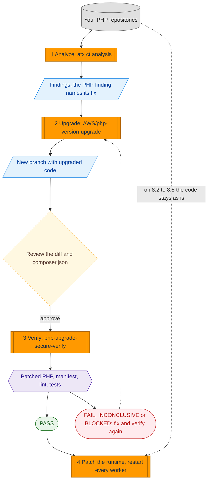

# PHP2Shell: patch the runtime, and get stuck PHP code onto it

A practical guide for **CVE-2026-109618** and **CVE-2026-109619** (PHP2Shell: CVSS v4.0 9.2, unauthenticated remote code execution
in the PHP engine, fixed on 2026-10-21). It shows how to use AWS Transform to find PHP that cannot move to a patched version, upgrade
it, and verify the result on a patched runtime before you ship.

| | |
|---|---|
| **Status** | Sample guidance, facts dated 2026-10-25. Read the [disclaimer](#disclaimer) |
| **Tested with** | AWS Transform CLI 3.20.0, `us-east-1`, Docker 25, Amazon Linux 2023 |
| **License** | MIT-0 (see the repository [LICENSE](../../LICENSE)) |

> **Upgrading code does not fix these CVEs.** The fix is a PHP runtime at **8.2.35, 8.3.36, 8.4.27 or 8.5.12** (or newer) with **every
> worker restarted**. Many teams are blocked because their code was written for PHP 7.4 or 8.0 and breaks on a supported version.
> Steps 1 to 3 remove that blocker. Step 4 is the fix.

## Do you need steps 1 to 3?

| You run... | Do this |
|---|---|
| PHP 8.2, 8.3, 8.4 or 8.5 | **Still vulnerable until you patch to 8.2.35, 8.3.36, 8.4.27 or 8.5.12.** These branches have a fix and the update stays inside the branch, so your code does not need to be upgraded: skip steps 1 to 3 and go to [step 4](#step-4-patch-the-runtime-and-restart-every-worker) |
| PHP 8.1 or older | No release fixes these branches ([AWS bulletin](https://aws.amazon.com/security/security-bulletins/2026-143-aws)). Migrate to a supported branch: follow all four steps. PHP published minimal source backports for 7.4, 8.0 and 8.1 for people who build from source ([php.net](https://www.php.net/archive/2026.php)), a stopgap rather than a supported release. CISA advises taking systems that cannot be patched offline ([Tenable FAQ](https://www.tenable.com/blog/php2shell-cve-2026-109618-cve-2026-109619-frequently-asked-questions-about-critical-php-remote)) |
| PHP you cannot find | Start with step 1, and use Amazon Inspector, Systems Manager Inventory and your container registries to build the list of hosts and images |

**Pick 8.4 or 8.5 as the migration target.** Security support ends on 2026-12-31 for 8.2, 2027-12-31 for 8.3, 2028-12-31 for 8.4 and
2029-12-31 for 8.5 ([php.net](https://www.php.net/supported-versions.php)). This guide uses 8.4; set it once and every command below reads it:

```bash
export TARGET=8.4
```

## The flow



Legend: grey cylinder = your code; orange = a step you run; blue = a result; yellow dashed diamond = a person decides; purple hexagon =
an automatic gate; green = passed; red = stopped.

## Before you start

- An AWS account and credentials with the managed policy `AWSTransformCustomFullAccess`; Node.js 22+; Git; Docker (step 3; other
  container CLIs are accepted through `CONTAINER_CLI` but were not tested).
- The AWS Transform CLI, in a [supported Region](https://docs.aws.amazon.com/transform/latest/userguide/custom-get-started.html):

```bash
curl -fsSL https://transform-cli.awsstatic.com/install.sh | bash
aws sts get-caller-identity          # credentials first: without them atx prints an error instead of its version
atx --version && atx ct --help       # 3.20.0 or later; the ct commands are continuous modernization
export AWS_REGION=us-east-1
```

- **A patched PHP and Composer on the machine that runs step 2.** The managed transformation runs your tests with the PHP it finds. In test runs,
  without PHP it spent 28 agent minutes and failed, and with an old PHP it validated on a vulnerable runtime. On Amazon Linux 2023:

```bash
sudo dnf install -y --releasever=2023.12.20261021 php$TARGET-cli php$TARGET-xml php$TARGET-mbstring composer
php -v                               # must show the patched release (8.4.27 or later for 8.4)
```

- Use **throwaway clones** of your repositories with a clean working tree, and a **disposable machine** for step 2 (the agent runs commands
  without asking).

## Step 1. Analyze with continuous modernization

```bash
atx ct source add --name my-php --provider local --path ~/repos        # a folder of git repositories
#   GitHub instead: --provider github --org <org> --token "$GITHUB_TOKEN"   (take the token from your secret store)
atx ct discovery scan --source my-php
atx ct analysis run --type rapid-techdebt-analysis --source my-php --wait     # about 1 minute per repository: reads composer.json
atx ct analysis run --type tech-debt-comprehensive --source my-php --wait     # 5 to 10+ minutes: reads the code
atx ct findings list --source my-php --status open --json                     # note the id of the PHP finding
```

On the sample app the rapid scan returned one high finding (PHP 7.4 is end of life, fix `AWS/php-version-upgrade`). The comprehensive
analysis returned 11 findings, including silent PHP 8 behavior changes that raise no error.

On a local source the analysis writes an `ATXDocumentation/` folder and a branch into each repository. Switch back to your branch and
remove them before step 2 (a remediation refuses a repository with uncommitted changes).

## Step 2. Upgrade with the managed transformation

`AWS/php-version-upgrade` migrates PHP code to PHP 8.5 unless told otherwise. It was **early access** on 2026-10-25 and not on the public
managed-transformations page, so confirm it exists in your account first:

```bash
atx custom def list | grep -i php            # must show AWS/php-version-upgrade; if not, upgrade the code your usual way and continue at step 3
```

Run it on one repository first, with a cost cap:

```bash
atx custom def exec -n AWS/php-version-upgrade -p ~/repos/svc -x -t -d --limit 100 \
  -g "{\"additionalPlanContext\":\"The target PHP version is $TARGET\"}"
```

- `-x` runs without asking you anything and `-t` lets the agent run every tool it wants (shell commands included) without a prompt: that is
  why the machine must be disposable.
- `-d` opts this run out of knowledge-item extraction. Use it for proprietary code.
- `--limit 100` caps the run at 100 agent minutes (US$ 3.50 at US$ 0.035 per agent minute). At the cap the CLI exits with code 2; run the
  same command with a higher `--limit` to resume.
- The same upgrade can be started from the finding with `atx ct remediation create --ids <finding-id> --name php-upgrade --local --wait`.
  That run has **no cost cap**.

The result is a new branch (`atx/php-version-upgrade-<timestamp>` or `atx-result-staging-<timestamp>`). Check it out and review it:

1. **`composer.json` must not allow an unpatched PHP.** In test runs the transformation wrote `"php": ">=8.4"` or `">=8.5"` (and once a
   `config.platform.php` of `"8.4"`). Both allow unpatched releases. Use the constraint for your target, and a matching platform pin if
   the file has one:

   | Target | `require.php` | `config.platform.php` (only if present) |
   |---|---|---|
   | 8.4 | `~8.4.27 \|\| ^8.5.12` | `8.4.27` |
   | 8.5 | `^8.5.12` | `8.5.12` |

   `>=8.4.27` is **not** enough: it also allows 8.5.0 to 8.5.11. Then run `composer update --lock` so `composer.lock` matches.
2. **Preserving behavior can preserve insecure behavior.** PHP 8 changed loose comparisons on purpose: `'abc' == 0` was true on 7.4 and is
   false on 8. That class of bug is behind loose-comparison authentication bypasses. In all three test runs the transformation kept the PHP 7 result
   in the sample's `Matcher::isZeroLike` and kept the test that asserts it. Review every `==`, `!=`, `switch` and `in_array` without strict
   mode on values that come from users, and prefer the PHP 8 result unless you have a reason. The secure version of the sample:

   ```php
   public function isZeroLike($value)
   {
       return $value == 0;            // PHP 8 semantics: a non-numeric string such as "abc" is not zero-like
   }
   // test: $this->assertFalse($m->isZeroLike("abc"));
   ```

3. Review the rest of the diff as you would any change: removed functions replaced, deprecations fixed, PHPUnit and dependencies updated.
4. If the run stopped at its limit or ended in a partial migration, resume with a higher `--limit`, or keep the branch and finish by hand.
   Step 3 tells you what is still broken.

## Step 3. Verify with the custom transformation in this folder

The managed transformation tests its work on whatever PHP is on the machine. In test runs that was PHP 8.5.3 and 8.4.26, both **unpatched**.
`php-upgrade-secure-verify/` closes that gap. It never edits your code. It runs your repository inside locked-down containers (no network,
read-only, no capabilities, unprivileged user) on the **official image of a patched PHP release**, and checks that:

1. the container's PHP is at or above the patched release of the branch and on the branch you asked for;
2. `composer.json` does not allow an unpatched or end-of-life PHP (checked with Composer's own version library);
3. every `.php`, `.phtml` and `.inc` file parses, `vendor/` included, and every file on disk was actually checked;
4. your tests pass, with at least one test executed (skipped, incomplete and risky tests do not count).

The official PHP image has only the core extensions. If your tests need `pdo_mysql`, `mysqli`, `gd`, `intl`, `zip` or `bcmath`, build your own
image on the patched base with those extensions and pass it as `PHP_IMAGE=your-image`; the version and branch checks still apply.

```bash
# Once, from this folder: register it in your account (an analysis-type transformation)
atx custom def publish -n php-upgrade-secure-verify --sd php-upgrade-secure-verify --category analysis \
  --description "Verify-only gate: runs migrated PHP on an official patched PHP image and writes a PASS/FAIL/INCONCLUSIVE/BLOCKED verdict"

# On the upgraded branch, install dependencies first (the gate has no network). For example:
docker run --rm --user "$(id -u):$(id -g)" -e COMPOSER_HOME=/tmp/c -v "$PWD":/app -w /app composer:2 install --no-scripts --no-plugins

# Run it as a continuous modernization custom analysis (one finding per failed check)...
atx ct analysis run --type custom --transformation-name php-upgrade-secure-verify \
  -g "additionalPlanContext=target=$TARGET" --repo my-php::svc --wait
# ...or directly on the checkout
atx custom def exec -n php-upgrade-secure-verify -p ~/repos/svc -x -t -d -g "{\"additionalPlanContext\":\"target=$TARGET\"}"
```

**Read `verify-verdict.json` in the repository, not the agent's summary.** The verdict comes from the script (`scripts/verify.sh`), which you
can also run by itself, with no agent and no cost: `bash php-upgrade-secure-verify/scripts/verify.sh ~/repos/svc $TARGET`.

| Verdict | Exit | Meaning |
|---|---|---|
| `PASS` | 0 | Patched PHP, safe manifest, every file parses, tests executed and passed |
| `FAIL` | 2 | PHP below the patched release or on the wrong branch, or `composer.json` allows an unpatched PHP |
| `FAIL` | 3 | A file does not parse |
| `FAIL` | 4 | Tests failed |
| `INCONCLUSIVE` | 5 | Everything checked is clean, but **no test executed**. `php -l` only finds parse errors: removed functions such as `each()` and changed behavior show up only in tests. Not verified |
| `BLOCKED` | 9 | Could not decide: no Docker, image unavailable, unknown target, unreadable files, test timeout or out-of-memory kill. Not verified |

CI should treat only exit 0 as success. The verdict also records `git_commit`, `git_branch` and `warnings` (for example, the end-of-life date
of 8.2). Before you run step 2 again on the same checkout, remove the two report files, `verify-verdict.json` and `VERIFY_REPORT.md`, because a
remediation refuses a repository with uncommitted changes.

On the sample app (target 8.5): the legacy code failed (exit 2: `"php": ">=7.4"`, plus a parse error); the upgraded code as the transformation
left it also failed (exit 2: `"php": ">=8.5"` allows 8.5.0 to 8.5.11) even though 7 of 7 tests passed; with `"php": "^8.5.12"` it passed. PHP
8.5.11 was rejected even when everything else was clean. Measured results and the full test matrix are in [BENCHMARKS.md](BENCHMARKS.md).

## Step 4. Patch the runtime and restart every worker

This is the fix. Nothing above closes the vulnerabilities.

**4.1 Install the patched release.**

| Where PHP runs | Action |
|---|---|
| Amazon Linux 2023 | Releases are locked to the one you installed, so a plain `dnf upgrade` can keep offering old PHP. Upgrade every PHP package of your branch to the release named in the advisory: `sudo dnf upgrade -y --releasever=2023.12.20261021 'php8.4*'` (php8.2: ALAS2023-2026-3301, php8.3: -3302, php8.4: -3303, php8.5: -3304). Keep the quoted wildcard: `dnf update php8.4` only targets the `php8.4` metapackage, and if you installed `php8.4-fpm` without it, nothing is updated and the command still exits 0 |
| Containers | Rebuild on a base image with a fixed release (for example `php:8.4.27-fpm`), push, redeploy |
| AWS Elastic Beanstalk | Updated PHP platform versions exist (8.2 to 8.5). Managed Platform Updates applies them in the next window; otherwise update the platform version yourself |
| Amazon Lightsail | AWS cannot update a running instance in place: create new instances from the updated blueprint and migrate |
| AWS Lambda | No managed PHP runtime. If PHP is yours (custom runtime or image), rebuild with a patched release and redeploy |
| Debian, Ubuntu, RHEL, LTS builds | Use your vendor's package. The version string may not change: trust the vendor advisory |

**4.2 Keep session upload progress off.** A separate flaw, CVE-2026-115560 (PHP advisory of 2026-10-23), is not fixed by these releases. It needs an
uncommon configuration, but PHP recommends `session.upload_progress.enabled=0` until its next regular release. It is on by default.

```bash
echo 'session.upload_progress.enabled=0' | sudo tee /etc/php.d/99-php2shell.ini     # the directory php --ini lists under "Scan for additional .ini files"
grep -rn 'upload_progress' /etc/php-fpm.d/ /etc/php-fpm.conf                         # a pool setting overrides php.ini: remove any that turns it back on
```

**4.3 Restart every worker.** A package upgrade does nothing for processes already in memory.

```bash
sudo systemctl restart php-fpm httpd               # every PHP-FPM service and every web server that loads PHP
```

**4.4 Confirm on each host** (read-only commands; paths are those of Amazon Linux 2023):

```bash
/usr/sbin/php-fpm -v                                                         # the binary that serves requests: at or above the patched release
rpm -qf --qf '%{NAME}-%{VERSION} installed %{INSTALLTIME:date}\n' /usr/sbin/php-fpm
ps -o lstart= -p "$(pgrep -o -f 'php-fpm: master')"                         # the master must start AFTER that install time
dnf updateinfo list --installed | grep ALAS2023-2026-3303                    # the advisory is installed (-3301, -3302, -3304 for 8.2, 8.3, 8.5)
php -r 'var_dump(ini_get("session.upload_progress.enabled"));'               # string(1) "0"
/usr/sbin/php-fpm -i | grep session.upload_progress.enabled                  # Off
```

On Amazon Linux the package changelog says only "Package updated to 8.4.27", so `rpm -q --changelog | grep CVE` finds nothing even on a patched
host: check the advisory with `dnf updateinfo` instead. With Apache `mod_php`, check the version of the package that provides the Apache module and
restart `httpd`. On other distributions, follow your vendor's advisory.

Until you can patch, PHP's advisories list interim settings that narrow the attack surface. They do not fix the vulnerabilities and every change
needs a worker restart: `memory_limit=-1` set so the application cannot override it (CVE-2026-109618, with a container memory limit as the real
ceiling), a low `post_max_size`, `session.upload_progress.enabled=0` (CVE-2026-109619), and on PHP 8.5 also `fatal_error_backtraces=0`. Keep the
last one after patching (step 4.2). If you use
AWS WAF, see the [AWS guidance](https://aws.amazon.com/blogs/security/using-aws-waf-to-apply-mitigations-for-php2shell-rce-vulnerabilities-cve-2026-109618-and-cve-2026-109619)
and update a pinned PHP managed rule group to the latest version.

## Troubleshooting

| Symptom | Cause and fix |
|---|---|
| `dnf update php8.4` prints "No packages marked for upgrade" but PHP is old | Only the metapackage was targeted. Use `sudo dnf upgrade -y --releasever=2023.12.20261021 'php8.4*'` |
| Step 3 `FAIL` exit 2, `manifest_reason` "allows unpatched or end-of-life PHP" | Set `require.php` as in step 2, item 1, then `composer update --lock` |
| Step 3 `FAIL` exit 2, "pins an unpatched release" | `config.platform.php` is below the floor. Set it to the floor (for example `8.4.27`) |
| Step 3 `INCONCLUSIVE` exit 5 | No test executed. Install dependencies (`composer install`) or add tests, then verify again |
| Step 3 `FAIL` exit 4 on tests that open a network connection | The gate has no network. Tag those tests with a PHPUnit group and run with `PHPUNIT_EXCLUDE_GROUP=<group>` |
| Step 3 `BLOCKED`, "linted N of M files" | Files the container user cannot read (for example a `vendor/` installed by root with private permissions), or symlinks that point outside the repository. Fix permissions or the links |
| Step 3 `BLOCKED`, timeout or killed | A suite slower than `TEST_TIMEOUT` (default 600 s), or a test using more than 2 GB. Raise `TEST_TIMEOUT` or fix the test |
| Step 3 `FAIL` exit 3 on a file under `vendor/` | An old dependency that does not parse on PHP 8. Update it. `LINT_VENDOR=0` skips `vendor/`, with a warning |
| Step 2 refuses the repository | Uncommitted changes, often the step 3 report files or `ATXDocumentation/`. Remove them first |
| Step 2 spends minutes and fails on a machine without PHP | Install a patched PHP and Composer first (see Before you start) |

## Known limitations

- The gate has no network: tests that need a database or another service fail or must be excluded.
- There is no baseline: a test that already failed before the migration is reported as a failure after it.
- The official image has only core extensions; use your own image on the patched base when you need others.
- A hostile project can fake its own test results. The containers reduce the impact of mistakes; they are not a boundary against a
  determined attacker.
- Only Docker was tested. Podman, Finch and nerdctl are accepted through `CONTAINER_CLI` but not verified.
- The image tag (`php:<release>-cli`) can be rebuilt by its maintainers; the version gate still checks the PHP version inside it. Pin a
  digest with `PHP_IMAGE=php@sha256:<digest>` if you need a fixed image.

## Disclaimer

- **Sample guidance, provided as is, without warranty (MIT-0, see the repository license).** It is not an AWS service, a security product or a compromise assessment.
  Test in a non-production environment first. You are responsible for your systems. Facts are dated 2026-10-25 and change quickly; if this
  page and an AWS bulletin disagree, the bulletin wins.
- **It does not patch anything** and **does not detect a compromise.** Amazon Threat Intelligence reported a first exploitation
  attempt on 2026-10-17, four days before the fixes, and broad exploitation since ([BleepingComputer](https://www.bleepingcomputer.com/news/security/amazon-says-php2shell-exploitation-began-4-days-before-patches/));
  if a system was exposed unpatched, investigate separately and rotate credentials the application could read. Start from at least 2026-10-17;
  a [community checklist](https://builder.aws.com/content/3L1O3OGdUB5loyuR2tCQKI9E3Yu/find-it-patch-it-watch-it-a-community-checklist-for-php2shell-on-aws)
  citing Aikido suggests looking back to at least June 2026 (for example, PHP files changed since then that you did not deploy).
- **It cannot see what is not in a repository you connect:** running services without source or infrastructure-as-code, PHP inside third-party
  products, or managed platforms' runtimes.
- **`AWS/php-version-upgrade` is early access.** It is an AI agent: review every diff. `-x -t` makes it run commands unattended, so use a
  disposable machine. The same flags apply when you run step 3 through the engine (running `verify.sh` by itself needs no agent). It is billed
  per agent minute, and the run started from a finding has no cost cap. The CLI collects usage telemetry by default; opt out with
  `ATX_DISABLE_TELEMETRY=true`.
- **A `PASS` is evidence, not proof.** It means no regressions in the code paths your tests cover, a safe manifest and a clean parse on a
  patched PHP. It does not show identical behavior. `INCONCLUSIVE` and `BLOCKED` mean not verified. The verification transformation is itself
  run by an agent: trust the script's exit code and `verify-verdict.json`.
- **Mitigations are not fixes.**

## Folder contents

```text
php2shell-patch-and-verify/
├── README.md                          this guide
├── BENCHMARKS.md                      what was measured, the gate's test matrix, and how to repeat it
├── php-upgrade-secure-verify/         the custom verify-only transformation (publish this folder)
│   ├── SKILL.md
│   ├── references/                    verdict contract, patched versions and safe constraints
│   └── scripts/verify.sh              the gate; can also be run on its own
└── samples/
    ├── legacy-php-app/                PHP 7.4 app with deliberate PHP 8 breakages
    └── legacy-php-app.php85.patch     the change AWS/php-version-upgrade produced for it, unedited
```

To apply the patch: `cd samples && git apply legacy-php-app.php85.patch` (it edits `legacy-php-app/` in place). It is the transformation's
real output, kept unedited on purpose: its `composer.json` constraint fails step 3, and its `Matcher` keeps the PHP 7 comparison (step 2, item 2).

`atx custom def publish` accepts only `SKILL.md`, `references/` and `scripts/` in the folder it publishes, which is why the transformation sits in its own subfolder.

## Contributing, security, license

[CONTRIBUTING](../../CONTRIBUTING.md) · [Code of Conduct](../../CODE_OF_CONDUCT.md) · security issues: do not open a public issue, see
[security issue notifications](../../CONTRIBUTING.md#security-issue-notifications) · the verification script pulls the official `php` and
`composer` Docker images at run time and does not redistribute them · license: [MIT-0](../../LICENSE).

**Sources:** [AWS Security Bulletin 2026-143-AWS](https://aws.amazon.com/security/security-bulletins/2026-143-aws) ·
[php.net security advisory](https://www.php.net/archive/2026.php) ·
[GHSA-w8hw-w9fx-j79w](https://github.com/php/php-src/security/advisories/GHSA-w8hw-w9fx-j79w) ·
[GHSA-6wmf-4rv5-p3rp](https://github.com/php/php-src/security/advisories/GHSA-6wmf-4rv5-p3rp) ·
[PHP supported versions](https://www.php.net/supported-versions.php) ·
[ALAS2023-2026-3301](https://alas.aws.amazon.com/AL2023/ALAS2023-2026-3301.html) to
[-3304](https://alas.aws.amazon.com/AL2023/ALAS2023-2026-3304.html) ·
[continuous modernization](https://docs.aws.amazon.com/transform/latest/userguide/continuous-modernization.html) ·
[pricing](https://aws.amazon.com/transform/pricing/) ·
[Amazon Linux 2023 update practice](https://docs.aws.amazon.com/linux/al2023/ug/updating-best-practice.html)
