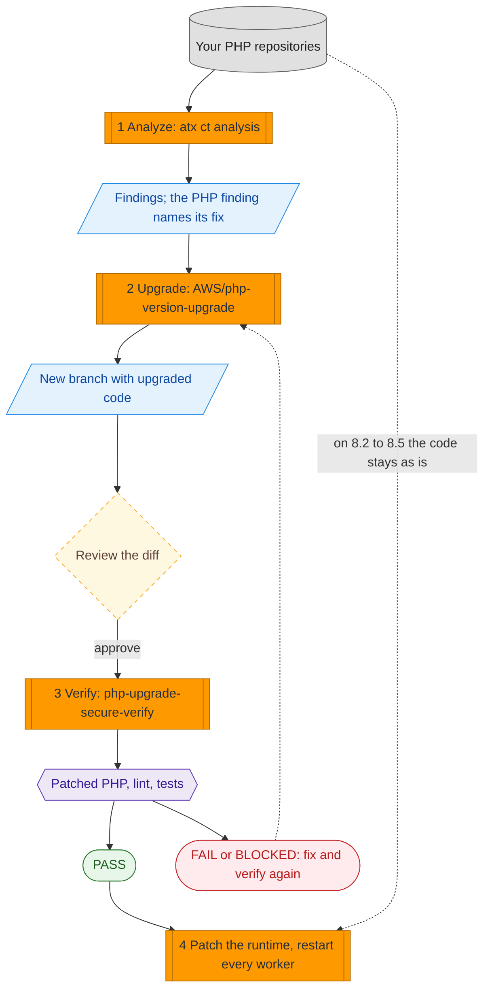

# PHP2Shell: patch the runtime, and get stuck PHP code onto it

A practical guide for **CVE-2026-109618** and **CVE-2026-109619** (PHP2Shell: CVSS v4.0 9.2, unauthenticated remote code execution
in the PHP engine, fixed on 2026-10-21). It shows how to use AWS Transform to find PHP that cannot move to a patched version, upgrade
it, and verify the result on a patched runtime before you ship.

| | |
|---|---|
| **Status** | Sample guidance, facts dated 2026-10-23. Read the [disclaimer](#disclaimer) |
| **Tested with** | AWS Transform CLI 3.20.0, `us-east-1`, Docker 25, Amazon Linux 2023 |
| **License** | MIT-0 (see the repository [LICENSE](../../LICENSE)) |

> **Upgrading code does not fix these CVEs.** The fix is a PHP runtime at **8.2.35, 8.3.36, 8.4.27 or 8.5.12** (or newer) with **every
> worker restarted**. Many teams are blocked because their code was written for PHP 7.4 or 8.0 and breaks on a supported version.
> Steps 1 to 3 remove that blocker. Step 4 is the fix.

## Do you need steps 1 to 3?

| You run... | Do this |
|---|---|
| PHP 8.2, 8.3, 8.4 or 8.5 | **Still vulnerable until you patch to 8.2.35, 8.3.36, 8.4.27 or 8.5.12.** These branches have a fix and the update stays inside the branch, so your code does not need to be upgraded: skip steps 1 to 3 and go to [step 4](#step-4-patch-the-runtime-and-restart-every-worker) |
| PHP 8.1 or older | There is no upstream fix for these branches ([AWS bulletin](https://aws.amazon.com/security/security-bulletins/2026-143-aws)). Migrate to a supported branch: follow all four steps. Tenable reports that PHP also published minimal source backports for 7.4 to 8.1 (a stopgap, not a supported release) and that CISA advises taking systems that cannot be patched offline ([Tenable FAQ](https://www.tenable.com/blog/php2shell-cve-2026-109618-cve-2026-109619-frequently-asked-questions-about-critical-php-remote)) |
| PHP you cannot find | Start with step 1, and use Amazon Inspector, Systems Manager Inventory and your container registries to build the list of hosts and images |

## The flow



Legend: grey cylinder = your code; orange = a step you run; blue = a result; yellow dashed diamond = a person decides; purple hexagon =
an automatic gate; green = passed; red = stopped.

## Before you start

- An AWS account and credentials with the managed policy `AWSTransformCustomFullAccess`; Node.js 22+; Git; Docker (step 3).
- The AWS Transform CLI, in a [supported Region](https://docs.aws.amazon.com/transform/latest/userguide/custom-get-started.html):

```bash
curl -fsSL https://transform-cli.awsstatic.com/install.sh | bash
aws sts get-caller-identity          # credentials first: without them atx prints an error instead of its version
atx --version && atx ct --help       # 3.20.0 or later; the ct commands are continuous modernization
export AWS_REGION=us-east-1
```

- Use **throwaway clones** of your repositories with a clean working tree, and a **disposable machine** for step 2 (the agent runs commands
  without asking).

## Step 1. Analyze with continuous modernization

```bash
atx ct source add --name my-php --provider local --path ~/repos        # a folder of git repositories
#   GitHub instead: --provider github --org <org> --token "$GITHUB_TOKEN"   (take the token from your secret store)
atx ct discovery scan --source my-php
atx ct analysis run --type rapid-techdebt-analysis --source my-php --wait     # about 1 minute per repository: reads composer.json
atx ct analysis run --type tech-debt-comprehensive --source my-php --wait     # 5 to 10+ minutes: reads the code
atx ct findings list --source my-php --status open --json                     # note the id of the PHP finding
```

On the sample app the rapid scan returned one high finding (PHP 7.4 is end of life, fix `AWS/php-version-upgrade`). The comprehensive
analysis returned 11 findings, including silent PHP 8 behavior changes that raise no error.

On a local source the analysis writes an `ATXDocumentation/` folder and a branch into each repository. Switch back to your branch and
remove them before step 2 (a remediation refuses a repository with uncommitted changes).

## Step 2. Upgrade with the managed transformation

`AWS/php-version-upgrade` migrates PHP code to PHP 8.5 by default. It was **early access** on 2026-10-23 and not on the public
managed-transformations page, so confirm it exists in your account first:

```bash
atx custom def list | grep -i php            # must show AWS/php-version-upgrade; if not, upgrade the code your usual way and continue at step 3
```

```bash
# From the finding (continuous modernization). Not cost-capped:
atx ct remediation create --ids <finding-id> --name php-upgrade --local --wait
# Or directly on one repository, capped at 100 agent minutes; pick the target branch yourself:
atx custom def exec -n AWS/php-version-upgrade -p ~/repos/svc -x -t --limit 100 \
  -g '{"additionalPlanContext":"The target PHP version is 8.4"}'
```

The result is a new branch (`atx/php-version-upgrade-<timestamp>` or `atx-result-staging-<timestamp>`). **Review the diff**, then check it out.
The default target (8.5) is written into `composer.json`; choose 8.4 if that is your standard. Billing is per agent minute
([pricing](https://aws.amazon.com/transform/pricing/)); [BENCHMARKS.md](BENCHMARKS.md) lists the minutes measured on the sample.

## Step 3. Verify with the custom transformation in this folder

The managed transformation tests its work on whatever PHP is on the machine. In our test that was PHP 8.5.3, which is **not** patched.
`php-upgrade-secure-verify/` closes that gap. It never edits your code. It runs your repository inside a locked-down
container (no network, read-only, no capabilities, unprivileged user) on the **official image of a patched PHP release**, and checks:

1. the container's PHP is at or above the patched release of the branch (8.2.35, 8.3.36, 8.4.27 or 8.5.12) and on the branch you asked for;
2. every `.php`, `.phtml` and `.inc` file passes `php -l`;
3. your tests pass, with at least one test executed (skipped tests do not count).

The official PHP image has only the core extensions. If your tests need `pdo_mysql`, `mysqli`, `gd`, `intl`, `zip` or `bcmath`, build your own
image on the patched base with those extensions and pass it as `PHP_IMAGE=your-image`; the version and branch checks still apply.

```bash
# Once, from this folder: register it in your account (an analysis-type transformation)
atx custom def publish -n php-upgrade-secure-verify --sd php-upgrade-secure-verify --category analysis \
  --description "Verify-only gate: runs migrated PHP on an official patched PHP image and writes a PASS/FAIL/BLOCKED verdict"

# On the upgraded branch, install dependencies with your usual pipeline (the gate has no network). For example:
docker run --rm --user "$(id -u):$(id -g)" -e COMPOSER_HOME=/tmp/c -v "$PWD":/app -w /app composer:2 \
  install --no-scripts --no-plugins --ignore-platform-reqs

# Run it as a continuous modernization custom analysis (findings per failed check)...
atx ct analysis run --type custom --transformation-name php-upgrade-secure-verify \
  -g "additionalPlanContext=target=8.5" --repo my-php::svc --wait
# ...or directly on the checkout
atx custom def exec -n php-upgrade-secure-verify -p ~/repos/svc -x -t -d -g '{"additionalPlanContext":"target=8.5"}'
```

**Read `verify-verdict.json` in the repository, not the agent's summary.** The verdict comes from the script
(`scripts/verify.sh`), which you can also run by itself, with no agent and no cost: `bash php-upgrade-secure-verify/scripts/verify.sh ~/repos/svc 8.5`.

| Verdict | Script exit | Meaning |
|---|---|---|
| `PASS`, evidence `executed-tests` | 0 | Patched PHP, every file parses, tests ran and passed |
| `PASS`, evidence `static-smoke` | 0 | Patched PHP and every file parses, but **no test ran** (no dependencies installed, or no tests). Weaker: `note` says why |
| `FAIL` | 2, 3 or 4 | 2: PHP below the patched release, or not on the branch you asked for. 3: a file does not parse. 4: tests failed (or PHPUnit found none) |
| `BLOCKED` | 9 | Could not run (Docker missing, image could not be pulled, unknown target, no PHP file found). Not verified |

Run on the sample app: the legacy code failed (`FAIL`, a PHP 7.4-only syntax that is a parse error on PHP 8), the upgraded code passed
(`PASS`, 7 of 7 tests on PHP 8.5.12), and PHP 8.5.11 was rejected even though everything else was clean. As a continuous modernization custom
analysis, a failed lint became a high finding that names `AWS/php-version-upgrade` as the fix, and a pass without dependencies became a low
finding "tests were not executed". Measured minutes are in [BENCHMARKS.md](BENCHMARKS.md).

## Step 4. Patch the runtime and restart every worker

This is the fix. Nothing above closes the vulnerabilities.

| Where PHP runs | Action |
|---|---|
| Amazon Linux 2023 | The repository is pinned to your installed release, so plain `dnf upgrade` can keep offering old PHP. Use the command in the advisory, then restart: `sudo dnf update php8.4 --releasever 2023.12.20261021` (php8.2: ALAS2023-2026-3301, php8.3: -3302, php8.4: -3303, php8.5: -3304) |
| Containers | Rebuild on a base image with a fixed release (for example `php:8.4.27-fpm`), push, redeploy |
| AWS Elastic Beanstalk | Updated PHP platform versions exist (8.2 to 8.5). Managed Platform Updates applies them in the next window; otherwise update the platform version yourself |
| Amazon Lightsail | AWS cannot update a running instance in place: create new instances from the updated blueprint and migrate |
| AWS Lambda | No managed PHP runtime. If PHP is yours (custom runtime or image), rebuild with a patched release and redeploy |
| Debian, Ubuntu, RHEL, LTS builds | Use your vendor's package. The version string may not change: trust the vendor advisory |

Confirm on each host (read-only commands):

```bash
php -v                                              # CLI only; at or above 8.2.35 / 8.3.36 / 8.4.27 / 8.5.12
php-fpm -v                                          # the binary that serves requests (php-fpm8.4 -v on some distributions); with Apache mod_php, check the package version instead
rpm -q --changelog php8.4 | grep -E "CVE-2026-109618|CVE-2026-109619"   # vendor builds: both ids must appear (Debian: zgrep in /usr/share/doc/<package>/changelog.Debian.gz)
sudo systemctl restart php-fpm httpd                # restart every PHP-FPM service and every web server that loads PHP
rpm -q --qf '%{INSTALLTIME:date}\n' php8.4; ps -o lstart= -p "$(pgrep -o -f 'php-fpm: master')"   # workers must start AFTER the install time
```

Until you can patch, PHP's advisories list interim settings that narrow the attack surface. They do not fix the vulnerabilities and every change
needs a worker restart: `memory_limit=-1` set so the application cannot override it (CVE-2026-109618, with a container memory limit as the real
ceiling), a low `post_max_size`, `session.upload_progress.enabled=0` (CVE-2026-109619), and on PHP 8.5 also `fatal_error_backtraces=0`. Keep
`session.upload_progress.enabled=0` even after patching: a separate, still unpatched flaw (CVE-2026-115560, PHP advisory of 2026-10-23) is a remote
code execution in session upload progress handling, in an uncommon configuration. If you use
AWS WAF, see the [AWS guidance](https://aws.amazon.com/blogs/security/using-aws-waf-to-apply-mitigations-for-php2shell-rce-vulnerabilities-cve-2026-109618-and-cve-2026-109619)
and update a pinned PHP managed rule group to the latest version.

## Disclaimer

- **Sample guidance, provided as is, without warranty (MIT-0, see the repository license).** It is not an AWS service, a security product or a compromise assessment.
  Test in a non-production environment first. You are responsible for your systems. Facts are dated 2026-10-23 and change quickly; if this
  page and an AWS bulletin disagree, the bulletin wins.
- **It does not patch anything** and **does not detect a compromise.** Tenable, citing Amazon Threat Intelligence, reports a first exploitation
  attempt on 2026-10-17 and broad exploitation since ([Tenable FAQ](https://www.tenable.com/blog/php2shell-cve-2026-109618-cve-2026-109619-frequently-asked-questions-about-critical-php-remote));
  if a system was exposed unpatched, investigate separately and rotate credentials the application could read. Start from at least 2026-10-17;
  a [community checklist](https://builder.aws.com/content/3L1O3OGdUB5loyuR2tCQKI9E3Yu/find-it-patch-it-watch-it-a-community-checklist-for-php2shell-on-aws)
  citing Aikido suggests looking back to at least June 2026 (for example, PHP files changed since then that you did not deploy).
- **It cannot see what is not in a repository you connect:** running services without source or infrastructure-as-code, PHP inside third-party
  products, or managed platforms' runtimes.
- **`AWS/php-version-upgrade` is early access.** It is an AI agent: review every diff. `-x -t` makes it run commands unattended and it may install
  a PHP toolchain on that machine, so use a disposable one. The same flags apply when you run step 3 through the engine (running `verify.sh` by
  itself needs no agent). It is billed per agent minute, and the run started from a finding has no cost cap.
  The CLI collects usage telemetry by default; opt out with `ATX_DISABLE_TELEMETRY=true`.
- **A `PASS` is evidence, not proof.** It means no regressions in the code paths your tests cover plus a clean parse on a patched PHP. It does not
  show identical behavior, and without tests it only shows the code parses. The verification transformation is itself run by an agent: trust the
  script's exit code and `verify-verdict.json`. Your project's code runs inside the container: Docker isolation reduces the impact of mistakes and of
  casual malicious code, but it is not a boundary against a determined attacker, and a hostile project can fake its own test results.
- **Mitigations are not fixes.**

## Folder contents

```text
php2shell-patch-and-verify/
├── README.md                          this guide
├── BENCHMARKS.md                      what was measured, and how to repeat it
├── php-upgrade-secure-verify/         the custom verify-only transformation (publish this folder)
│   ├── SKILL.md
│   ├── references/                    verdict contract, patched versions
│   └── scripts/verify.sh              the gate; can also be run on its own
└── samples/
    ├── legacy-php-app/                PHP 7.4 app with deliberate PHP 8 breakages
    └── legacy-php-app.php85.patch     the change AWS/php-version-upgrade produced for it
```

`atx custom def publish` accepts only `SKILL.md`, `references/` and `scripts/` in the folder it publishes, which is why the transformation sits in its own subfolder.

## Contributing, security, license

[CONTRIBUTING](../../CONTRIBUTING.md) · [Code of Conduct](../../CODE_OF_CONDUCT.md) · security issues: do not open a public issue, see
[security issue notifications](../../CONTRIBUTING.md#security-issue-notifications) · the verification script pulls the official `php` Docker image
at run time and does not redistribute it · license: [MIT-0](../../LICENSE).

**Sources:** [AWS Security Bulletin 2026-143-AWS](https://aws.amazon.com/security/security-bulletins/2026-143-aws) ·
[GHSA-w8hw-w9fx-j79w](https://github.com/php/php-src/security/advisories/GHSA-w8hw-w9fx-j79w) ·
[GHSA-6wmf-4rv5-p3rp](https://github.com/php/php-src/security/advisories/GHSA-6wmf-4rv5-p3rp) ·
[ALAS2023-2026-3301](https://alas.aws.amazon.com/AL2023/ALAS2023-2026-3301.html) to
[-3304](https://alas.aws.amazon.com/AL2023/ALAS2023-2026-3304.html) ·
[continuous modernization](https://docs.aws.amazon.com/transform/latest/userguide/continuous-modernization.html) ·
[pricing](https://aws.amazon.com/transform/pricing/) ·
[Amazon Linux 2023 update practice](https://docs.aws.amazon.com/linux/al2023/ug/updating-best-practice.html)
